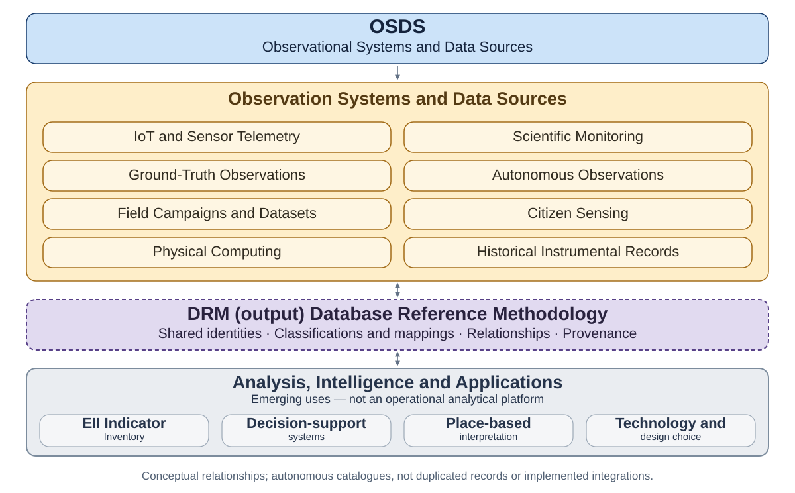

# Observational Systems and Data Sources (OSDS)

[View full-size diagram](assets/diagrams/osds_federation.svg).

## Introduction

Observational Systems and Data Sources (OSDS) catalogues observational systems, IoT data sources, physical sensor networks, scientific monitoring, ground-truth observations and physical computing datasets. It supports the discovery and interpretation of observation sources within the Ecological Information federation. The inventory contains **62 candidate source records, not 62 verified datasets**.

OSDS is a work-in-progress academic research resource. Providers, observing networks, site registries, archives, repositories and individual datasets are distinct entities. Identifying a source or reviewing its discovery URL does not establish measurement quality, calibration, dataset availability, access rights or suitability for a particular analysis.

## Research Scope

The eight disciplinary domains are Environmental, Ecological, Terrestrial, Hydrological, Agricultural, Urban, Industrial and Experimental. The eight observation categories are IoT telemetry, Scientific monitoring, Ground-truth observations, Autonomous observations, Campaign datasets, Citizen sensing, Physical computing and Historical instrumental records.

Domains and observation categories are independent, many-to-many classifications: a source may have multiple memberships in either dimension. Existing assignments, coverage statements and unresolved identity or overlap questions remain research assertions requiring evidence and review. The diagram’s selected examples illustrate the inventory; they do not introduce a new taxonomy or certify the listed sources.

## Methodology and Federation

The [Machine Reference](OSDS_Machine_Reference.md) remains the authoritative structured register; the scientific register is its human-readable presentation. Stable source identifiers and provenance distinguish original inventory assertions from dated discovery evidence. Source identity verification does not verify every dataset, classification or measurement associated with a provider.

The Database Reference Methodology (DRM) is under development in the [Ecological Information umbrella](https://github.com/ecological-interaction/ecological-information). OSDS alignment remains developmental, without an approved detailed specification or certification. OSDS and EII domain codes are not equivalent because their numbers match; documented identities, evidence and explicit mappings are needed for future interoperability.

OSDS addresses observation-source discovery, GISDS geographic resources, and EII ecological indicators. Each retains independent records and responsibilities. The diagram expresses conceptual relationships and emerging uses, not merged databases, automated ingestion or operational interoperability. Detailed version distinctions, candidate standards, provenance qualifications and publication history remain in the [research notes](RESEARCH_NOTES.md).

## Scientific Reference Register

Read the [Scientific Reference Register](OSDS_Scientific_Reference_Register.md) for the complete domain-organised catalogue, source descriptions, discovery links, classifications and verification limitations. Both registers retain document version 0.1.2; no research release or DOI is assigned.

Research by Jonathan Minchin, Ecological Interaction ([ORCID 0000-0001-8152-1796](https://orcid.org/0000-0001-8152-1796)); see [citation metadata](CITATION.cff) and [changelog](CHANGELOG.md). No repository licence has been selected. Public access and citation do not grant reuse permission; third-party datasets retain their own access, attribution and licence conditions.
