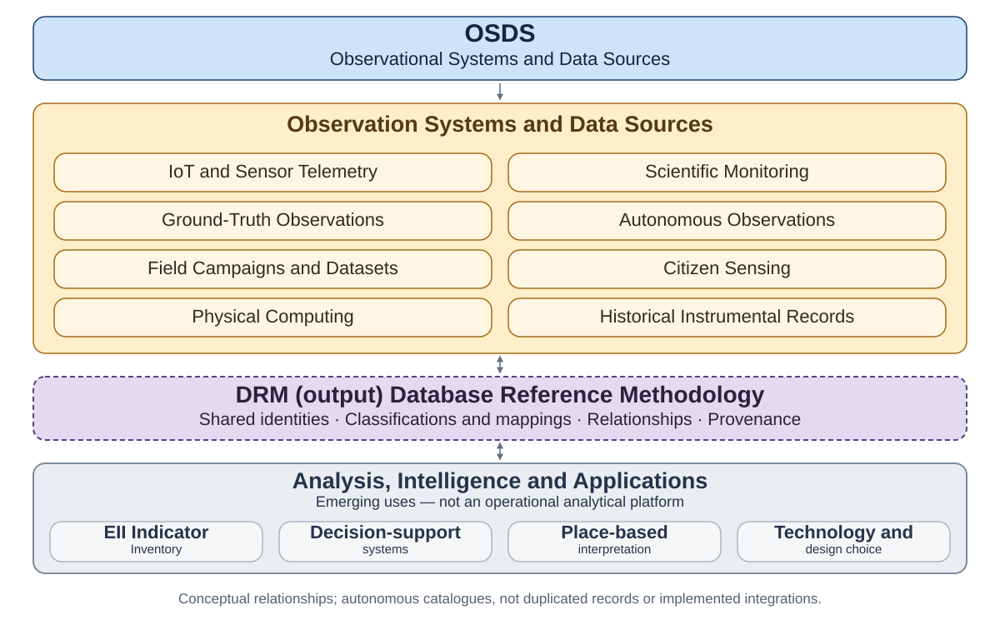

# Observational Systems and Data Sources (OSDS)

[View full-size diagram](assets/diagrams/osds_federation.svg).

## Introduction

Observational Systems and Data Sources (OSDS) catalogues observational systems, IoT data sources, physical sensor networks, scientific monitoring, ground-truth observations and physical computing datasets. It supports the discovery and interpretation of observation sources within the Ecological Information federation. The inventory contains **62 candidate source records, not 62 verified datasets**.

OSDS is a work-in-progress academic research resource. Organisations/providers, observing networks and systems, platforms or stations, instruments, site registries, archives, repositories, services and individual datasets are distinct descriptions or entity roles. The original source records keep platform, instrument and observation slots separate and unpopulated; listing a network or service does not identify a particular instrument or dataset. Identifying a source or reviewing its discovery URL does not establish measurement quality, calibration, dataset availability, access rights or suitability for a particular analysis.

## Research Scope

The eight disciplinary domains are Environmental, Ecological, Terrestrial, Hydrological, Agricultural, Urban, Industrial and Experimental. The eight observation categories are IoT telemetry, Scientific monitoring, Ground-truth observations, Autonomous observations, Campaign datasets, Citizen sensing, Physical computing and Historical instrumental records.

Disciplinary domains describe the subject grouping; observation categories describe the recorded observation pathways. They are distinct, potentially overlapping dimensions, not interchangeable classifications. The model permits multiple memberships: the current inventory records 62 primary-domain memberships, no secondary-domain assignments and 158 observation-category memberships (220 total). No recorded secondary assignment means none is recorded, not that each source belongs exclusively to one domain. Existing assignments, coverage statements and unresolved identity or overlap questions remain research assertions requiring evidence and review. The diagram’s selected examples illustrate the inventory; they do not introduce a new taxonomy or certify the listed sources.

## Methodology and Federation

The [Machine Reference](OSDS_Machine_Reference.md) remains the authoritative structured register; the scientific register is its human-readable presentation. Stable source identifiers and provenance distinguish original inventory assertions from dated discovery evidence. Source identity verification does not verify every dataset, classification or measurement associated with a provider.

The [Database Reference Methodology (DRM)](https://github.com/ecological-interaction/DRM) remains under development. DRM-MSP 0.1.0 review revision 2 is an unadopted methodological candidate. DRM records the bounded Phase 4 documentary-preservation pilots as completed and closed; this does not establish scientific verification, general MSP adoption or release, full DRM conformance or authorisation for Phase 5. OSDS and EII domain codes are not equivalent because their numbers match; documented identities, evidence and explicit mappings are needed for future interoperability.

OSDS addresses observation-source discovery, GISDS geographic resources, and EII ecological indicators. Each retains independent records and responsibilities. The diagram expresses conceptual relationships and emerging uses, not merged databases, automated ingestion or operational interoperability. Detailed version distinctions, candidate standards, provenance qualifications and publication history remain in the [research notes](RESEARCH_NOTES.md).

## Scientific Reference Register

Read the [Scientific Reference Register](OSDS_Scientific_Reference_Register.md) for the complete domain-organised catalogue, source descriptions, discovery links, classifications and verification limitations. Both registers now use document version 0.2.0. A separate `osds.documentary-research/0.1.0` extension accompanies the unchanged source-schema and inventory-classification identities; the earlier documentary maintenance remains recorded history. No research release or DOI is assigned. Formal family/theme definitions and original conversation coverage remain incomplete; product-level evidence, access and rights remain outstanding.

## Candidate research update

The [Scientific research sections](OSDS_Scientific_Reference_Register.md#candidate-research-expansion--document-020) add sixteen provisional instrument families with audit-reported examples, measured-property claims and candidate inferences; observation and validation methods; physical computing and computational interpretation; four proposed theme umbrellas and six descriptive dimensions. The [Machine Reference](OSDS_Machine_Reference.md#candidate-research-block) retains exhaustive typed candidates, reported decisions, conflicts and evidence. This augments the unchanged 62-source inventory: it does not verify hardware, adopt taxonomy or authenticate unavailable original scientific messages.

The local Git repository has a configured OSDS origin and committed research baseline. Website publication is separate: the central manifest pins an approved source revision rather than following local edits. This local candidate-research revision is not deployed by changing source files. See [research and publication notes](RESEARCH_NOTES.md) for the distinction.

Research by Jonathan Minchin, Ecological Interaction ([ORCID 0000-0001-8152-1796](https://orcid.org/0000-0001-8152-1796)); see [citation metadata](CITATION.cff) and [changelog](CHANGELOG.md). No repository licence has been selected. Public access and citation do not grant reuse permission; third-party datasets retain their own access, attribution and licence conditions.
